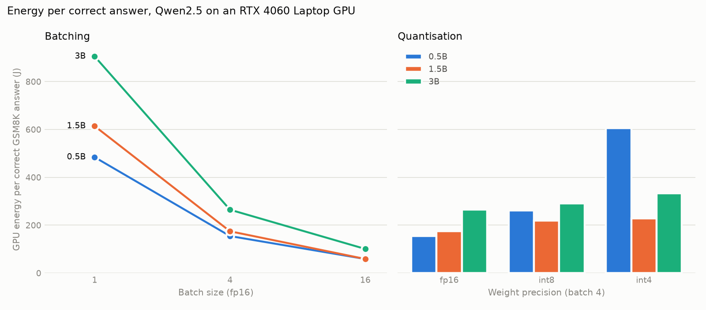

# From Words to Watts, on a laptop

[From Words to Watts](https://arxiv.org/abs/2310.03003) (Samsi et al., IEEE HPEC 2023)
measured the speed and energy of LLaMA inference on V100 and A100 GPUs. It reported
tokens and energy per second, per token and per response, and left three things for
later: whether the answers were right, quantisation, and continuous batching.

I repeated the method on the GPU I have, an RTX 4060 Laptop (8 GB, 80 W), with
smaller models, and added all three. Counting only the answers that are correct
changes some of the conclusions.

The short version: batching cuts energy per correct answer by 8 to 10 times.
Quantising saved no energy here. 8-bit was slower and 4-bit lost too many answers.
When replies vary in length, static batching costs 20 to 43% more per token, because
finished replies wait as padding. Continuous batching in vLLM removes that gap
completely and halves energy per token overall.

## Method

Kept from the paper:

- Two prompt sets, [GSM8K](https://huggingface.co/datasets/openai/gsm8k) (maths word
  problems) and [Alpaca](https://huggingface.co/datasets/tatsu-lab/alpaca)
  (instructions).
- Sampling at temperature 0.8 and top-p 0.95.
- GPU power read from `nvidia-smi` every 100 ms. Energy is mean power times run time.
- The same metrics: words, tokens and responses per second, and energy per token and
  per response.

Changed to fit 8 GB:

- Qwen2.5 0.5B, 1.5B and 3B Instruct instead of LLaMA 7B to 65B.
- 128 prompts per run instead of 4,096, and up to 256 new tokens instead of 512 to 1,024.
- Batch sizes 1, 4 and 16 instead of 64 to 512.
- Hugging Face `generate` with static batching. Prompts are padded on the left and a
  batch runs until its longest reply ends.

Added:

- **Accuracy on GSM8K**, graded on the number after "Answer:" in the reply. Dividing
  energy by correct answers gives **joules per correct answer**, which is what a user
  actually pays for.
- **8-bit and 4-bit weights** through bitsandbytes, at batch 4.
- **Continuous batching** with vLLM, on the same prompts at the same concurrency.

Each run is one model at one precision answering 128 prompts at one batch size. There
are 24 static-batching runs and 12 vLLM runs. Peak GPU temperature stayed between 45 and 64°C, so nothing throttled.

## Results

### Batching

GSM8K, fp16. Accuracy is uncertain by about ±7 points at 128 questions.

| Model | Batch | Tokens/s | Watts | J/token | Accuracy | J per correct answer |
|---|---|---|---|---|---|---|
| 0.5B | 1 | 38 | 24 | 0.64 | 30% | 484 |
| 0.5B | 4 | 138 | 30 | 0.21 | 32% | 155 |
| 0.5B | 16 | 507 | 40 | 0.08 | 30% | 59 |
| 1.5B | 1 | 32 | 47 | 1.48 | 50% | 614 |
| 1.5B | 4 | 97 | 41 | 0.42 | 50% | 175 |
| 1.5B | 16 | 317 | 49 | 0.16 | 54% | 59 |
| 3B | 1 | 24 | 57 | 2.37 | 59% | 905 |
| 3B | 4 | 85 | 55 | 0.65 | 55% | 265 |
| 3B | 16 | 259 | 67 | 0.26 | 57% | 101 |

At batch 1 the GPU spends most of its time waiting on memory, so it draws 24 to 57 W
and produces few tokens. At batch 16 it draws only 2 to 15 W more but produces 10 to 13
times the tokens. This is the paper's main point and it holds at this scale.

The accuracy column changes which model looks best. Per token, 0.5B costs half or
less of what 1.5B costs at every batch size. Per correct answer, they tie at batch 16, and 1.5B
gets almost twice as many right. Picking the cheapest model per token would have
picked the wrong one.

### Quantisation

GSM8K, batch 4.

| Model | Weights | Tokens/s | Watts | J/token | Accuracy | J per correct answer |
|---|---|---|---|---|---|---|
| 0.5B | fp16 | 138 | 30 | 0.21 | 32% | 155 |
| 0.5B | int8 | 32 | 12 | 0.36 | 32% | 261 |
| 0.5B | int4 | 102 | 19 | 0.19 | 7% | 605 |
| 1.5B | fp16 | 97 | 41 | 0.42 | 50% | 175 |
| 1.5B | int8 | 23 | 14 | 0.58 | 54% | 219 |
| 1.5B | int4 | 104 | 40 | 0.38 | 38% | 228 |
| 3B | fp16 | 85 | 55 | 0.65 | 55% | 265 |
| 3B | int8 | 20 | 17 | 0.83 | 62% | 291 |
| 3B | int4 | 77 | 47 | 0.62 | 41% | 334 |

**8-bit costs more energy, not less.** bitsandbytes' 8-bit kernels ran 4 to 5 times
slower than fp16. The GPU drew a third of the power, but for four times as long. It
kept accuracy (the 3B gap of 55% against 62% is inside the noise).

**4-bit saves a little per token and loses a lot of answers.** Energy per token fell
5 to 13%, but GSM8K accuracy fell 12 to 25 points, and the 0.5B model went from 32%
to 7%. Per correct answer, 4-bit was the most expensive option for every model.

Quantisation mainly buys memory. 3B took 5.9 GB in fp16 and 2.2 GB in 4-bit. On a
card where the fp16 model does not fit that matters. Here everything fit, so it bought
nothing.

### Padding

Alpaca costs more per token than GSM8K, but only when batched:

| Model | Batch 1 | Batch 4 | Batch 16 |
|---|---|---|---|
| 0.5B | +1% | +41% | +43% |
| 1.5B | -7% | +30% | +42% |
| 3B | -1% | +26% | +21% |

At batch 1 the two prompt sets cost the same, so it is not the prompts themselves.
Alpaca replies are shorter (130 to 170 tokens on average, against 205 to 230 for
GSM8K) and vary twice as much: the standard deviation of reply length is about 100
tokens, against 43 to 56. GSM8K replies are more uniform partly because 40 to 67% of
them run to the 256-token limit. In a static batch every reply waits for the longest
one, and the GPU keeps working on the finished ones as padding.

### Continuous batching

vLLM keeps a fixed number of replies in flight and starts the next prompt the moment
one finishes, so nothing waits as padding. I ran the fp16 grid again in vLLM 0.8.5,
with the same prompts, sampling and power meter, and the same number of replies in
flight as the static batch size.

| Model | Data | In flight | Static J/token | vLLM J/token | Saving |
|---|---|---|---|---|---|
| 0.5B | GSM8K | 4 | 0.214 | 0.109 | 49% |
| 0.5B | GSM8K | 16 | 0.078 | 0.038 | 51% |
| 0.5B | Alpaca | 4 | 0.303 | 0.107 | 65% |
| 0.5B | Alpaca | 16 | 0.112 | 0.038 | 66% |
| 1.5B | GSM8K | 4 | 0.424 | 0.250 | 41% |
| 1.5B | GSM8K | 16 | 0.155 | 0.082 | 47% |
| 1.5B | Alpaca | 4 | 0.551 | 0.246 | 55% |
| 1.5B | Alpaca | 16 | 0.220 | 0.081 | 63% |
| 3B | GSM8K | 4 | 0.652 | 0.485 | 26% |
| 3B | GSM8K | 16 | 0.259 | 0.144 | 44% |
| 3B | Alpaca | 4 | 0.819 | 0.473 | 42% |
| 3B | Alpaca | 16 | 0.313 | 0.142 | 55% |

**The padding gap disappears.** Under vLLM, Alpaca costs 1 to 2% *less* per token
than GSM8K in all six pairs, against 21 to 43% more with static batches. GSM8K accuracy
matched the static runs within noise.

**Not all of the saving is continuous batching.** vLLM also has faster attention and
memory management, which is why GSM8K, with little padding to remove, still saves 26
to 51%. The extra 11 to 16 points that Alpaca saves on top is the part that comes from
not padding.

**vLLM needs spare memory to help.** It keeps a cache of every reply in flight. The 3B
model takes 5.8 GB of the 8 GB card. At 90%, vLLM's cache held only a few replies at a
time, and on one attempt less than one, so it refused to start. In that state 3B at 16 in flight came out 13% *worse* than static
batching. Raising vLLM's share of the card from 90 to 93% gave a cache of 7,392 tokens,
enough for all 16, and the result became the 44% saving above.

## What I could not test

- **Power capping.** The paper's best result was capping the A100 at 175 W, which cut
  energy 23% for 6.7% more time. This laptop's GPU reports its power limit to
  `nvidia-smi` as N/A, so I could not repeat it.
- **Larger models and batches.** 8 GB limits this to 3B and batch 16. The paper's
  batches started at 64.
- **Compiled vLLM.** vLLM normally compiles the model with `torch.compile`, which
  needs a C compiler that my WSL install lacks. All vLLM runs are uncompiled (eager),
  like the static runs.

## Limitations

- 128 prompts per run. Accuracy differences under about 10 points are noise. Speed and
  energy are much more stable than accuracy, since every run generates 15,000 to 30,000
  tokens.
- Energy is the GPU board's reading only. The CPU, memory and the rest of the laptop
  are not counted.
- One run per setting, on one machine. I did not repeat runs to measure the spread.
- Generation length is capped at 256 tokens, so some GSM8K working is cut off and
  graded wrong. This affects all settings equally.
- Static batching through `generate` is the simplest way to serve a model, not the
  fastest. Throughput here is lower than a production server would get.
- The vLLM runs used WSL on the same laptop, so they share the GPU with Windows. The
  0.5B and 1.5B vLLM runs used 90% of the card and the 3B runs 93%. The smaller models
  had far more cache than 16 replies need either way.
- A first pass with vLLM's default scheduler settings, which process up to 8,192
  prompt tokens per step, still showed Alpaca 15 to 34% dearer at 16 in flight for
  0.5B and 1.5B. Capping that at 1,024 tokens made the gap vanish. I changed the memory
  share at the same time, so I have not isolated which setting caused it.

## Run it

Needs an NVIDIA GPU and the CUDA build of PyTorch.

    python -m venv .venv
    .venv\Scripts\pip install torch --index-url https://download.pytorch.org/whl/cu124
    .venv\Scripts\pip install -r requirements.txt
    .venv\Scripts\python bench.py --smoke   # checks the grader, then one short run
    .venv\Scripts\python bench.py           # the full grid, about 3.5 hours here
    .venv\Scripts\python analyze.py         # prints the tables, writes energy.png

`bench.py` appends each run to `results.jsonl` as it finishes and skips runs already
there, so it can be stopped and restarted. The results from this laptop are included,
so `analyze.py` runs without a GPU.

vLLM needs Linux. On Windows, in WSL with Ubuntu, from this folder:

    python3 -m venv ~/w2w && ~/w2w/bin/pip install vllm==0.8.5.post1 transformers==4.51.3 datasets==3.6.0
    ~/w2w/bin/python vbench.py              # the 12 vLLM runs, about 15 minutes here

vLLM 0.8.5 is built on PyTorch 2.6 with CUDA 12.4, which this laptop's driver
supports. The transformers and datasets pins are versions from the same period. The
newest versions of both failed with it here.

| File | What it does |
|---|---|
| `bench.py` | Runs the static-batching grid and measures power, speed and accuracy |
| `vbench.py` | Runs the fp16 grid again in vLLM, with the same measurements |
| `analyze.py` | Prints the tables and draws `energy.png` |
| `results.jsonl` | One line per static run, every measured field |
| `results-vllm.jsonl` | One line per vLLM run, with every reply's length |
